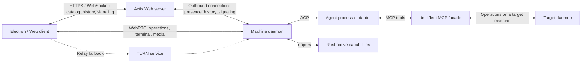

# deskfleet architecture

deskfleet manages AI agents and their working environments across a team's
computers. Users can browse workspaces and session history, inspect Git state,
and access terminals or desktops on the machine doing the work.

This document describes the planned system. The current implementation contains
the Rust resource model, an Actix Web liveness endpoint, and an independent
TypeScript daemon calling a napi-rs addon. The daemon runs from source or a SEA
executable, exposes native information and a local health endpoint, and runs
Codex CLI sessions through ACP. Native WebRTC peers, DataChannels, and on-demand
capture/encoding are available through the daemon's native API. The Electron
client uses authenticated local IPC for desktop signaling and Chromium WebRTC
for decoding and playback in its sandboxed Vue renderer. It stays in the tray
independently of the daemon.

## Components



| Component | Responsibility | Implementation |
| --- | --- | --- |
| Central server | Team membership, machine registration, catalog, stored session history, presence, access control, and signaling | Rust / Actix Web |
| Machine daemon | Workspace configuration, agent supervision, ACP clients, terminals, Git access, and history synchronization | TypeScript / Node.js SEA |
| Native libraries | OS integration and performance-sensitive transport, capture, input, and media work | Rust with napi-rs bindings |
| Desktop application | User interface, platform integration, and daemon installation/management | Electron / TypeScript |
| Web application | Server-hosted catalog, history, and browser-supported remote access | TypeScript |
| MCP facade | Let agents discover resources and operate on explicit remote targets | TypeScript, sharing deskfleet client operations |

The server owns team membership and shared access policy. Each daemon owns its
machine's workspace configuration, files, processes, and live session state. The
server stores synchronized views so users can browse history while a machine is
offline; clients show when that data was last observed.

The backend is open source in this repository under Apache-2.0. Shared resource
and protocol types remain independent of Actix Web and Node-API.

## Resource model

```text
Team
  Machine
    TerminalSessions [machine scope]
    Workspace
      TerminalSessions [workspace scope]
      Worktree
        Directory bindings [one or more]
        AgentSessions
        TerminalSessions [worktree scope]
```

| Resource | Meaning |
| --- | --- |
| Team | Membership and shared access boundary |
| Machine | An enrolled daemon installation and its OS user execution context |
| Workspace | A grouping of related worktrees on one machine |
| Worktree | A working context binding directories and agent sessions within a workspace |
| Directory binding | A named path on the worktree's machine |
| AgentSession | A provider session belonging to one worktree, with its startup directory context |
| TerminalSession | A terminal owned by one Machine, Workspace, or Worktree, with a separate cwd |

A deskfleet Worktree can span repositories and directories. It is not necessarily
one native Git worktree, branch, or checkout. A directory binding may reference
a normal checkout, a native Git worktree, a subdirectory, or a directory without
Git. Existing directories can be registered directly.

For example:

```text
Machine: development-box
  Workspace: storefront
    Worktree: main
      frontend -> /code/storefront-web
      backend  -> /code/storefront-api
      AgentSession: investigate checkout failures
    Worktree: checkout-fix
      frontend -> /worktrees/storefront-web/checkout-fix
      backend  -> /worktrees/storefront-api/checkout-fix
      AgentSession: implement the fix
```

Each checkout has its own branch, HEAD, and changes. Worktree summaries preserve
that attribution. Resource IDs are independent of names, paths, and repository
URLs. Resources on different machines remain distinct even when they share a
repository remote.

A terminal's scope determines its association and access policy. Its cwd can
change without reparenting the terminal. Machine and workspace terminals need no
placeholder worktree. Resource ownership itself does not sandbox a shell's
filesystem access.

## Daemon and session lifecycle

The daemon runs independently of Electron, normally as the OS user whose files,
credentials, and tools the agents use. Closing the app or losing a connection
must leave ongoing work running. Local clients connect over authenticated IPC,
such as a Unix-domain socket or Windows named pipe.

The desktop client stays resident in the system tray (the macOS menu bar or the
Windows notification area). Closing its window or using an ordinary quit command
hides it. The tray menu, OS session end, or a termination signal exits the client
process.

The daemon is the ACP client and owns local agent processes or adapter
connections. Each AgentSession belongs to a worktree. Startup records the cwd
and directory bindings; later edits to the worktree must not silently retarget a
running session. Additional directories are exposed through the provider's
supported configuration or tools.

The first provider connects Codex CLI through the bundled
[Codex ACP adapter](https://github.com/agentclientprotocol/codex-acp). The shared
`AgentProvider` interface accepts a user-facing name, an optional binary path,
and environment overrides. Provider-specific code selects the process; the
[ACP TypeScript SDK](https://agentclientprotocol.com/libraries/typescript) handles
initialization, session creation, prompts, cancellation, and session updates.
Codex uses the installed CLI and its credentials. The adapter runs as a child
process; the SEA executable reuses its bundled Node runtime.

The current agent CLI creates one ACP session per prompt invocation. Its cwd and
provider session ID remain distinct from deskfleet's Worktree and AgentSession
resources. It forwards ACP updates without converting them into a history schema.
Permission requests require a client callback; without one they are cancelled.
The CLI cancels them explicitly. The client advertises no filesystem or terminal
capabilities.

ACP capability negotiation determines which operations an adapter supports.
Claude Code, Pi, and Cursor CLI are further integration candidates. Managed
sessions, imported history, resumed sessions, and attachment to an existing CLI
process are distinct capabilities. ACP alone does not guarantee live attachment;
a tmux connection can expose the CLI without providing structured ACP control.

Agent events feed deskfleet's session view and stored history. Preserve the
provider's session identifier and relevant provider metadata alongside the
common conversation, tool, approval, and state events. Credentials remain on the
executing machine. ACP approval callbacks do not confine agents that execute
tools directly.

Reconnecting clients attach to the current session without resubmitting prompts.
Multiple observers must not produce conflicting control or approval responses;
the control policy will be defined with the session API. Disconnect never grants
approval.

Daemon restart recovery depends on the provider and terminal backend. Reconcile
stored history with available processes and report interrupted sessions. On
supported Unix systems, tmux can keep terminals alive across daemon restarts;
other PTY backends expose their own recovery capabilities.

## Remote access and coordination

Machines make outbound connections to the central server. Peer connections are
created on demand.

| Traffic | Transport |
| --- | --- |
| Authentication, enrollment, catalog, and history | HTTPS |
| Presence, history synchronization, and WebRTC signaling | Authenticated WebSocket or HTTPS streams |
| Terminal dial, hangup, catalog and lifecycle events | Authenticated signaling; IPC for the local client |
| Interactive operations, Git queries, terminal I/O and resize | WebRTC DataChannel |
| Desktop video/audio | WebRTC media tracks |
| Desktop input | WebRTC DataChannel |
| Local client operations | Authenticated IPC |

Deploy STUN and TURN alongside signaling. TURN provides relay access when peers
cannot connect directly. Desktop streaming, terminal traffic, and bulk results
need flow control appropriate to their latency and throughput; validate this
with the selected WebRTC implementation.

The native transport uses `webrtc-rs` with configurable STUN/TURN servers,
trickle ICE, reliable ordered DataChannels, RTP media tracks, and RTCP feedback.
`PeerSessions` gives the daemon ownership of peer creation and shutdown. These
are exposed to the local Electron client over authenticated Unix-domain sockets
or Windows named pipes. Central server signaling, remote enrollment, and remote
operation routing remain to be connected. Chromium receives the media into a
standard HTML video element; a separate native GPU rendering window is deferred.
See [native media](media.md) for codec support, capture lifecycle, and validation.

Electron terminals use a data-only peer on the same signaling infrastructure.
The daemon owns native PTYs independently of their viewers; disconnect detaches,
and an existing terminal can be listed and reattached without restarting its
shell. The UI supports local machine-scoped terminals. See
[terminal integration](terminals.md) for dial/hangup, durable history, and flow
control.

Git inspection starts with the Git CLI's machine-readable output. Resolve each
directory to its checkout and retrieve branch, HEAD, status, and diffs. Query a
shared checkout once when several bindings point to it. Non-Git directories stay
usable. Initial Git support is read-only; live queries require the daemon.

MCP tools let an agent discover authorized machines and resources, inspect state,
and request operations on an explicit target. Remotely created sessions belong
to worktrees on that target machine. The agent coordinates related work across
machines; deskfleet does not create a global Project or synchronize repository
contents automatically.

The MCP facade shares the same operations and permissions as human clients.
Its placement and provider configuration will be selected during integration.

## History and authorization

The central server stores synchronized conversation and tool history, not just
session names. The daemon retains unsynchronized events during server outages.
Synchronization must tolerate retries and distinguish incomplete history from a
complete recording. Choose the database, event format, and replay mechanism when
implementing persistence.

Live commands require an available target machine. Terminal output is persisted
on the owning daemon until explicit hangup so a different client can reconstruct
the session. Reconnecting does not restart the shell. Daemon restart retains the
transcript and marks lost processes interrupted. Desktop media remains transient.

Authorize history access, prompts, approvals, terminal input, and desktop control
as separate actions. Both the server and target daemon enforce the caller's
scope. Authenticate remote peers and local IPC callers; a WebRTC connection or
signaling access alone does not authorize machine operations.

Agent MCP calls carry delegated authority. Generated arguments cannot broaden
that authority, and discovery exposes only permitted resources. Remote actions
remain attributable to their initiating user/session and target resource.

Remote access needs an expiry and revocation policy that also works during
control-plane outages. Local work follows the machine's execution policy;
revoking a client's access and cancelling a running task are separate actions.
Define grant lifetimes and renewal behavior with enrollment and authentication.

The initial design trusts the server with synchronized history. Keep machine
private keys and application credentials out of history and logs. Define
retention and deletion when adding storage. Electron renderers stay sandboxed,
with narrow preload interfaces; agent output and repository content are
untrusted display data.

## Native code and distribution

Keep reusable Rust logic separate from napi-rs wrappers, following Heron's
core-crate, binding, and TypeScript-service structure. Native operations must
avoid blocking Node's event loop. Keep capture and encoding data in native code
where passing frames through JavaScript would add unnecessary copies.

Node.js SEA packages the daemon and native addon with the pinned Node runtime.
The addon is extracted to a private temporary directory before loading. See the
[daemon guide](../../apps/daemon/README.md) for packaging and platform support.
Agent adapters and external tools may have their own runtime requirements.

Desktop capability is optional and initialized on demand. Missing displays or
capture permissions must not prevent agents, Git, or terminals from working.
Determine whether capture needs a process in the logged-in graphical session
when implementing the platform backend.

## Repository and protocol

The Rust workspace contains:

| Crate | Responsibility |
| --- | --- |
| `deskfleet-model` | Resource IDs, directory bindings, and session associations |
| `deskfleet-protocol` | Shared wire contracts and protocol version |
| `deskfleet-native` | Native capabilities independent of Node.js |
| `deskfleet-capture` | Native display capture and retained GPU surfaces |
| `deskfleet-encoder` | VideoToolbox/NVENC video encoding and Opus audio encoding |
| `deskfleet-nvenc` | Windows NVENC session and D3D11 resource ownership |
| `deskfleet-nvenc-sys` | Windows NVENC FFI and runtime driver loading |
| `deskfleet-node` | napi-rs wrapper over native capabilities |
| `deskfleet-server` | Actix Web application in `apps/server` |

Dependencies flow `server -> protocol -> model`, `node -> native -> capture/encoder`, and
`@deskfleet/daemon -> @deskfleet/native`. The pnpm workspace currently contains
the daemon, the desktop client, and the native package. TypeScript wire types
should derive from the same authoritative contracts as Rust; napi declarations
describe the native API separately.

`PROTOCOL_VERSION` stays at `1` until the first freeze is explicitly declared.
Contracts evolve in place, including incompatible changes. Do not add version
bump tasks or compatibility layers for earlier provisional shapes.

mise manages tools and tasks with lockfile mode enabled. APM owns the checked-in
skills. See the [development environment](environment.md), [CI workflow](ci.md),
and [agent guide](../../AGENTS.md) for repository conventions.

## Next milestone

Daemon/native packaging and the first ACP provider are implemented. Next add a
second ACP provider and authenticated WebRTC with direct and TURN-relayed terminal
access.

Then complete one workflow: enroll a headless machine, register a workspace and
a worktree spanning frontend/backend directories, run an agent, inspect its Git
state from another machine, and open terminals at each supported scope. Work
continues after closing the client, reconnecting restores the session view, and
synchronized history remains available while the machine is offline.

MCP coordination and desktop control follow that workflow. Remaining choices
include provider distribution, terminal backends, Linux capture/encoding,
authenticated signaling, and persistence schema.

## References

- [Actix Web](https://actix.rs/docs/getting-started/)
- [ACP transports](https://agentclientprotocol.com/protocol/v1/transports)
- [ACP capabilities](https://agentclientprotocol.com/protocol/v1/initialization)
- [ACP session setup](https://agentclientprotocol.com/protocol/v1/session-setup)
- [WebRTC connectivity](https://webrtc.org/getting-started/peer-connections)
- [Node.js SEA native addons](https://nodejs.org/api/single-executable-applications.html#using-native-addons-in-the-injected-main-script)
- [Node-API ABI boundaries](https://nodejs.org/api/n-api.html#implications-of-abi-stability)
- [Electron sandboxing](https://www.electronjs.org/docs/latest/tutorial/sandbox)
- [Heron napi crate](https://github.com/minori-live/heron/blob/main/crates/dsp-node/Cargo.toml)
- [Heron native packaging](https://github.com/minori-live/heron/blob/main/apps/desktop/electron-builder.yml)
